

 

<!-- Social icons — original brand colours -->

&nbsp;

&nbsp;

&nbsp;

---

## 👋 About Me

I'm **Abhiram B S** — an engineering student at **Vidyavardhaka College of Engineering (VVCE), Mysuru**, on track to graduate in **2029**.

My story with code started the way all great ones do — no roadmap, no plan, just curiosity and a leap of faith into the unknown. Pure **vibecoding**: chasing whatever felt exciting, building things that probably shouldn't have worked, breaking them completely, and then — in that frustration — actually *understanding* them. That trial-by-fire way of learning is baked into how I think now, and I wouldn't trade it for anything.

These days I channel it into something more intentional: **Spec-Driven Development**. It means taking a problem down to its bones — pulling apart every abstraction until nothing is a mystery — then building back up with clarity and purpose. I love the moment when something truly *clicks*: not just knowing *how* a system works, but feeling in your gut *why* it works that way. Android internals, low-level architectures, system utilities — that's where my curiosity lives.

Outside of code, I point a camera at the world. Photography gave me a completely different lens — patience, composition, and the quiet satisfaction of catching light at exactly the right moment. Find my frames at **[@fstop.manual](https://www.instagram.com/fstop.manual/)** on Instagram.

🧠 &nbsp;**Comfortable with** — C &nbsp;·&nbsp; C++ &nbsp;·&nbsp; Python &nbsp;·&nbsp; Java  
⚙️ &nbsp;**Also working with** — Kotlin · Jetpack Compose · AIDL / Binder IPC · ADB Shell

---

## 🛠 Tech Stack

| Domain | Tools |
|:---:|:---|
| **Languages** |  &nbsp;  &nbsp;  &nbsp;  &nbsp;  |
| **Android & Systems** |  &nbsp;  &nbsp;  |
| **Web & Fullstack** |  &nbsp;  &nbsp;  |
| **Tooling** |  &nbsp;  &nbsp;  |

---

## 🎮 Contribution Calendar

> **Real commits — no fakes.** This calendar is generated directly from my GitHub contribution data via a GitHub Action that runs daily. Each block is a real day I pushed code. The snake eats through them in chronological order — just like the journey itself.

<picture>
  <source media="(prefers-color-scheme: dark)"  srcset="https://raw.githubusercontent.com/Abhi-ram-init/Abhi-ram-init/output/snake-dark.svg"/>
  <source media="(prefers-color-scheme: light)" srcset="https://raw.githubusercontent.com/Abhi-ram-init/Abhi-ram-init/output/snake.svg"/>
  
</picture>

🐍 Snake runs on real contribution data · updated every 24 h via <a href=".github/workflows/snake.yml">GitHub Actions</a>

---

## 🚀 Featured Projects

<table>
<tr>
<td width="33%" align="center" valign="top">

### 📱 [NetworkToggle](https://github.com/Abhi-ram-init/NetworkToggle)

 &nbsp; 

Fast **5G / 4G network mode** toggle for Android. Privileged Shizuku AIDL Binder IPC, direct ADB socket control, clean Jetpack Compose UI.

</td>
<td width="33%" align="center" valign="top">

### 🏎️ [CPU Monitor](https://github.com/Abhi-ram-init/CPU_Monitor)

Desktop telemetry widget — **Nissan Skyline GT-R (R34)** style. Real-time CPU/RAM tracking with animated wheel dynamics that react to hardware load.

</td>
<td width="33%" align="center" valign="top">

### 🌐 [Gladiconnect](https://github.com/Abhi-ram-init/Gladiconnect)

 &nbsp; 

NGO management portal — **volunteer onboarding**, event coordination, and automated digital certificate generation.

</td>
</tr>
</table>

---

*"Every complex system was once an intuition deconstructed line by line."*

 

**Let's build something interesting** — ideas, problems, or just a good conversation about systems.

 

&nbsp;

&nbsp;

  

⚡ Crafted with Spec-Driven spirit by <strong>Abhiram B S</strong>

