

  

<!-- Original full-color company logos (no badge boxes) -->

&nbsp;&nbsp;&nbsp;&nbsp;

&nbsp;&nbsp;&nbsp;&nbsp;
<a href="https://github.com/Abhi-ram-init" target="_blank" title="GitHub">
  <picture>
    <source media="(prefers-color-scheme: dark)" srcset="assets/icons/github-light.svg"/>
    <source media="(prefers-color-scheme: light)" srcset="assets/icons/github-dark.svg"/>
    
  </picture>
</a>

---

## ⚡ About Me

| Profile | Spec |
|:---|:---|
| 👨‍💻 **Name** | **Abhiram B S** |
| 🎓 **College** | Vidyavardhaka College of Engineering (VVCE), Mysuru · **2029** |
| 🧠 **Core Languages** | `C` · `C++` · `Python` · `Java` |
| 🚀 **Evolution** | Started with **vibecoding** → **Spec-Driven Dev** *(learning from scratch step by step)* |
| 🤝 **Interests** | Helping out &amp; building **interesting ideas** |
| 📸 **Photography** |  &nbsp;<a href="https://www.instagram.com/fstop.manual/">@fstop.manual</a> |

 

---

## 🛠 Tech Stack

| Focus | Technologies |
|:---:|:---:|
| **Core Comfort** |  &nbsp;  &nbsp;  &nbsp;  |
| **Explored in Projects** |  &nbsp;  &nbsp;  &nbsp;  &nbsp;  &nbsp;  |
| **Tools & Environment** |  &nbsp;  &nbsp;  |

---

## 🧱 Contribution Calendar

---

## 🚀 Featured Projects

<table>
<tr>
<td width="33%" align="center" valign="top">

### 📱 [NetworkToggle](https://github.com/Abhi-ram-init/NetworkToggle)

 &nbsp; 

Fast **5G / 4G network mode** switcher for Android with privileged Shizuku AIDL Binder IPC, direct ADB socket execution, and Jetpack Compose UI.

</td>
<td width="33%" align="center" valign="top">

### 🏎️ [CPU Monitor](https://github.com/Abhi-ram-init/CPU_Monitor)

**Nissan Skyline GT-R (R34)** desktop telemetry widget tracking live CPU and RAM load with animated hardware-reactive wheels.

</td>
<td width="33%" align="center" valign="top">

### 🌐 [GladiConnect](https://github.com/Abhi-ram-init/gladiators-ngo)

 &nbsp;  &nbsp; 

Role-based **NGO ecosystem** platform linking NGOs, volunteers, and CSR contributors with event &amp; impact workflows.

</td>
</tr>
</table>

---

 

*"Every complex system was once an intuition — deconstructed patiently, one layer at a time."*

 

**Got an interesting idea or tough bug?** Always down to learn, collaborate, and build something cool.

 

&nbsp;&nbsp;&nbsp;&nbsp;

&nbsp;&nbsp;&nbsp;&nbsp;
<a href="https://github.com/Abhi-ram-init" target="_blank" title="GitHub">
  <picture>
    <source media="(prefers-color-scheme: dark)" srcset="assets/icons/github-light.svg"/>
    <source media="(prefers-color-scheme: light)" srcset="assets/icons/github-dark.svg"/>
    
  </picture>
</a>

  

⚡ Crafted with Spec-Driven spirit by <strong>Abhiram B S</strong>

